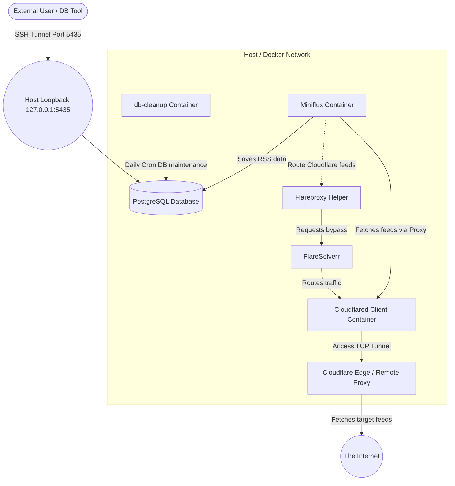

# Miniflux Deployment & Installation Guide

This document is a self-contained deployment guide designed to allow an administrator or an automation agent/model to replicate and run the entire Miniflux container stack end-to-end.

---

## 1. System Architecture

The stack consists of the following services configured to work in unison:



---

## 2. Directory Structure Setup

To run this stack, create a directory (e.g., `/root/miniflux`) with the following layout:

```text
miniflux/
├── .env
├── cleanup-cron
├── diagnose_proxy.sh
├── docker-compose.yml
└── flareproxy/
    ├── Dockerfile
    ├── app.py
    └── requirements.txt
```

---

## 3. Self-Contained Setup Scripts

Run the following commands in your shell to automatically recreate all configuration and source files in your current working directory.

### Create the flareproxy subdirectory
```bash
mkdir -p flareproxy
```

### Write: [.env](file:///root/miniflux/.env)
```bash
cat << 'EOF' > .env
POSTGRES_PASSWORD=REDACTED
ADMIN_PASSWORD=REDACTED
CLEANUP_ARCHIVE_UNREAD_DAYS=15
CLEANUP_ARCHIVE_READ_DAYS=2

# Cloudflare Access Service Token
CF_CLIENT_ID=REDACTED.access
CF_CLIENT_SECRET=REDACTED
EOF
```

### Write: [docker-compose.yml](file:///root/miniflux/docker-compose.yml)
```bash
cat << 'EOF' > docker-compose.yml
version: "3.8"

services:
  miniflux:
    image: miniflux/miniflux:latest
    ports:
      - "9292:8080"
    depends_on:
      db:
        condition: service_healthy
      cloudflared-client:
        condition: service_started
    environment:
      - DATABASE_URL=postgres://miniflux:${POSTGRES_PASSWORD}@db/miniflux?sslmode=disable
      - RUN_MIGRATIONS=1
      - CREATE_ADMIN=1
      - ADMIN_USERNAME=admin
      - ADMIN_PASSWORD=${ADMIN_PASSWORD}
      # Tell Miniflux to route all feed fetching through the tunnel client container
      - PROXY_URL=http://cloudflared-client:8888
      - FETCHER_ALLOW_PRIVATE_NETWORKS=1
      - INTEGRATION_ALLOW_PRIVATE_NETWORKS=1
      - CLEANUP_ARCHIVE_UNREAD_DAYS=${CLEANUP_ARCHIVE_UNREAD_DAYS}
      - CLEANUP_ARCHIVE_READ_DAYS=${CLEANUP_ARCHIVE_READ_DAYS}
      - HTTP_CLIENT_TIMEOUT=120
    restart: always

  db:
    image: postgres:15
    ports:
      - "127.0.0.1:5435:5432"
    environment:
      - POSTGRES_USER=miniflux
      - POSTGRES_PASSWORD=${POSTGRES_PASSWORD}
      - POSTGRES_DB=miniflux
    volumes:
      - miniflux-db:/var/lib/postgresql/data
    healthcheck:
      test: ["CMD", "pg_isready", "-U", "miniflux"]
      interval: 10s
      start_period: 30s
    restart: always

  cloudflared-client:
    image: cloudflare/cloudflared:latest
    container_name: cloudflared-client
    restart: unless-stopped
    # Opens a secure connection using the Cloudflare Service Token credentials
    # and binds to 0.0.0.0 so the Miniflux container can talk to it
    command: >
      access tcp
      --hostname tinyproxy.panos.pet
      --url 0.0.0.0:8888
      --service-token-id ${CF_CLIENT_ID}
      --service-token-secret ${CF_CLIENT_SECRET}

  flaresolverr:
    image: ghcr.io/flaresolverr/flaresolverr:latest
    container_name: flaresolverr
    environment:
      - LOG_LEVEL=info
      # Route FlareSolverr's outgoing traffic through the tunnel client to maintain network exit consistency
      - PROXY=http://cloudflared-client:8888
    depends_on:
      - cloudflared-client
    restart: unless-stopped

  flareproxy:
    build: ./flareproxy
    container_name: flareproxy
    ports:
      - "8000:8000"
    environment:
      - FLARESOLVERR_URL=http://flaresolverr:8191/v1
      - GUNICORN_CMD_ARGS=--timeout 120
    depends_on:
      - flaresolverr
    restart: unless-stopped

  db-cleanup:
    image: postgres:15-alpine
    container_name: db-cleanup
    environment:
      - PGPASSWORD=${POSTGRES_PASSWORD}
      - CLEANUP_ARCHIVE_UNREAD_DAYS=${CLEANUP_ARCHIVE_UNREAD_DAYS}
      - CLEANUP_ARCHIVE_READ_DAYS=${CLEANUP_ARCHIVE_READ_DAYS}
    volumes:
      - ./cleanup-cron:/etc/periodic/daily/cleanup-feed-entries
    entrypoint: ["sh", "-c", "chmod +x /etc/periodic/daily/cleanup-feed-entries && exec crond -f -l 2"]
    depends_on:
      db:
        condition: service_healthy
    restart: unless-stopped

volumes:
  miniflux-db:
EOF
```

### Write: [cleanup-cron](file:///root/miniflux/cleanup-cron)
```bash
cat << 'EOF' > cleanup-cron
#!/bin/sh
echo "Starting daily Miniflux database cleanup task..."

# Set defaults if not provided in environment
CLEANUP_ARCHIVE_UNREAD_DAYS=${CLEANUP_ARCHIVE_UNREAD_DAYS:-15}
CLEANUP_ARCHIVE_READ_DAYS=${CLEANUP_ARCHIVE_READ_DAYS:-2}

echo "Pruning unread entries older than $CLEANUP_ARCHIVE_UNREAD_DAYS days and read entries older than $CLEANUP_ARCHIVE_READ_DAYS days..."

# Construct the age-based delete clauses if they are not -1
DELETE_CLAUSE=""
if [ "$CLEANUP_ARCHIVE_READ_DAYS" -ne -1 ]; then
    DELETE_CLAUSE="(status = 'read' AND published_at < NOW() - INTERVAL '$CLEANUP_ARCHIVE_READ_DAYS days')"
fi

if [ "$CLEANUP_ARCHIVE_UNREAD_DAYS" -ne -1 ]; then
    if [ -n "$DELETE_CLAUSE" ]; then
        DELETE_CLAUSE="$DELETE_CLAUSE OR "
    fi
    DELETE_CLAUSE="${DELETE_CLAUSE}(status = 'unread' AND published_at < NOW() - INTERVAL '$CLEANUP_ARCHIVE_UNREAD_DAYS days')"
fi

if [ -n "$DELETE_CLAUSE" ]; then
    psql -h db -U miniflux -d miniflux -c "
    DELETE FROM entries e
    WHERE e.starred = false
      AND ($DELETE_CLAUSE);
    "
fi

# Run the optimized DELETE query to keep only the last 5000 entries per feed (excluding starred articles)
psql -h db -U miniflux -d miniflux -c "
WITH keeping AS (
    SELECT id
    FROM (
        SELECT id, ROW_NUMBER() OVER (PARTITION BY feed_id ORDER BY published_at DESC, id DESC) as rn
        FROM entries
    ) t
    WHERE t.rn <= 5000
)
DELETE FROM entries e
WHERE e.starred = false
  AND NOT EXISTS (
    SELECT 1 FROM keeping k WHERE k.id = e.id
  );
"

# Run VACUUM FULL ANALYZE to reclaim physical disk space and rebuild optimizer statistics
psql -h db -U miniflux -d miniflux -c "VACUUM FULL ANALYZE entries;"

echo "Database cleanup task completed successfully."
EOF
chmod +x cleanup-cron
```

### Write: [flareproxy/Dockerfile](file:///root/miniflux/flareproxy/Dockerfile)
```bash
cat << 'EOF' > flareproxy/Dockerfile
FROM python:3.10-slim

WORKDIR /app

COPY requirements.txt .
RUN pip install --no-cache-dir -r requirements.txt

COPY app.py .

EXPOSE 8000

CMD ["gunicorn", "--bind", "0.0.0.0:8000", "app:app"]
EOF
```

### Write: [flareproxy/app.py](file:///root/miniflux/flareproxy/app.py)
```bash
cat << 'EOF' > flareproxy/app.py
import os
import re
import html
import requests
from flask import Flask, request, Response

app = Flask(__name__)
FLARESOLVERR_URL = os.environ.get("FLARESOLVERR_URL", "http://flaresolverr:8191/v1")

@app.route('/feed')
def fetch_feed():
    target_url = request.args.get('url')
    if not target_url:
        return "Missing 'url' query parameter", 400

    payload = {
        "cmd": "request.get",
        "url": target_url,
        "maxTimeout": 60000
    }

    try:
        # Forward request to FlareSolverr
        r = requests.post(FLARESOLVERR_URL, json=payload, timeout=70)
        res = r.json()

        if res.get('status') == 'ok':
            solution = res.get('solution', {})
            response_text = solution.get('response', '')
            
            # If the browser wrapped the XML in a <pre> block (common for XML files rendered in Chromium)
            if "<pre" in response_text:
                match = re.search(r'<pre[^>]*>(.*?)</pre>', response_text, re.DOTALL | re.IGNORECASE)
                if match:
                    response_text = match.group(1)
                response_text = html.unescape(response_text)
            
            response_text = response_text.strip()
            
            # Return solved feed XML with appropriate content-type
            return Response(response_text, mimetype='application/xml')
        else:
            return f"FlareSolverr Error: {res.get('message')}", 502

    except Exception as e:
        return f"Proxy Error: {str(e)}", 500

if __name__ == '__main__':
    app.run(host='0.0.0.0', port=8000)
EOF
```

### Write: [flareproxy/requirements.txt](file:///root/miniflux/flareproxy/requirements.txt)
```bash
cat << 'EOF' > flareproxy/requirements.txt
flask==3.0.3
requests==2.31.0
gunicorn==22.0.0
EOF
```

### Write: [diagnose_proxy.sh](file:///root/miniflux/diagnose_proxy.sh)
```bash
cat << 'EOF' > diagnose_proxy.sh
#!/bin/bash

PROXY_PORT=${1:-8888}

echo "=================================================="
echo "          PROXY SERVICE DIAGNOSTIC SYSTEM          "
echo "=================================================="
echo "Date: $(date)"
echo "Target Port: $PROXY_PORT"
echo ""

echo "[1] Checking systemd service status..."
if command -v systemctl >/dev/null 2>&1; then
    systemctl is-active tinyproxy >/dev/null 2>&1
    if [ $? -eq 0 ]; then
        echo " -> Tinyproxy systemd service: ACTIVE (Running)"
    else
        echo " -> Tinyproxy systemd service: INACTIVE or NOT FOUND"
    fi
else
    echo " -> systemctl not available on this system."
fi
echo ""

echo "[2] Checking Docker containers..."
if command -v docker >/dev/null 2>&1; then
    DOCKER_STATUS=$(docker ps --filter "ancestor=*tinyproxy*" --filter "status=running" --format "{{.Names}} (ID: {{.ID}})")
    if [ ! -z "$DOCKER_STATUS" ]; then
        echo " -> Tinyproxy Docker container found active:"
        echo "$DOCKER_STATUS"
    else
        echo " -> No active Tinyproxy Docker containers found."
    fi
else
    echo " -> Docker not installed or running."
    exit 1
fi
echo ""

echo "[3] Checking network listening sockets on port $PROXY_PORT..."
if command -v ss >/dev/null 2>&1; then
    SS_OUTPUT=$(ss -tlnp | grep ":$PROXY_PORT")
    if [ ! -z "$SS_OUTPUT" ]; then
        echo " -> Port $PROXY_PORT is listening:"
        echo "$SS_OUTPUT"
    else
        echo " -> Nothing is listening on port $PROXY_PORT."
    fi
elif command -v netstat >/dev/null 2>&1; then
    NETSTAT_OUTPUT=$(netstat -tlnp | grep ":$PROXY_PORT")
    if [ ! -z "$NETSTAT_OUTPUT" ]; then
        echo " -> Port $PROXY_PORT is listening:"
        echo "$NETSTAT_OUTPUT"
    else
        echo " -> Nothing is listening on port $PROXY_PORT."
    fi
else
    echo " -> 'ss' or 'netstat' commands are not available."
fi
echo ""

echo "[4] Checking UFW status..."
if command -v ufw >/dev/null 2>&1; then
    sudo ufw status | grep -E "$PROXY_PORT|Anywhere" 2>/dev/null || echo " -> Port $PROXY_PORT not explicitly referenced in active rules."
else
    echo " -> UFW is not installed or active."
fi
echo ""

echo "[5] Locating Tinyproxy configuration..."
CONF_PATHS=("/etc/tinyproxy/tinyproxy.conf" "/etc/tinyproxy.conf" "/usr/local/etc/tinyproxy/tinyproxy.conf")
FOUND_CONF=""
for path in "${CONF_PATHS[@]}"; do
    if [ -f "$path" ]; then
        FOUND_CONF="$path"
        break
    fi
done

if [ ! -z "$FOUND_CONF" ]; then
    echo " -> Found config at: $FOUND_CONF"
    echo " -> Configured Listen Port/Address:"
    grep -E "^Port|^Listen" "$FOUND_CONF" 2>/dev/null
    echo " -> Configured Access Control Rules (Allow):"
    grep -E "^Allow" "$FOUND_CONF" 2>/dev/null
else
    echo " -> Standard tinyproxy.conf file not found in default paths."
fi

echo "=================================================="
EOF
chmod +x diagnose_proxy.sh
```

---

## 4. Launching the Stack

Once the setup script has successfully written all files, start the container stack:

```bash
# Set secure permission constraints on the directory files
chmod 0600 .env
chmod +x cleanup-cron
chmod +x diagnose_proxy.sh

# Spin up the docker containers
docker compose up -d --build
```

---

## 5. Verification

To verify that the installation has succeeded and is running end-to-end:

1. **Verify container status**:
   ```bash
   docker compose ps
   ```
   All 6 services should have a state of `running` (with `db` healthy).

2. **Access the Miniflux Dashboard**:
   Open a browser to `http://<host-ip>:9292` and log in using the `admin` username and your defined `ADMIN_PASSWORD` from [.env](file:///root/miniflux/.env).

3. **Check Cloudflared Tunnel Connection**:
   Ensure `cloudflared-client` has successfully authenticated and built the TCP proxy bridge:
   ```bash
   docker compose logs cloudflared-client
   ```

4. **Verify Flareproxy Routing**:
   To fetch Cloudflare-protected feeds, construct subscription URLs in Miniflux using the helper address:
   `http://flareproxy:8000/feed?url=https://protected-rss-site.com/feed.xml`
